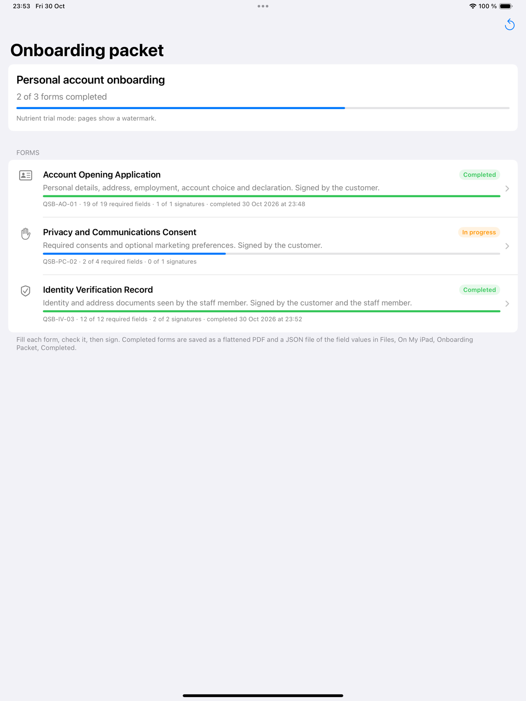
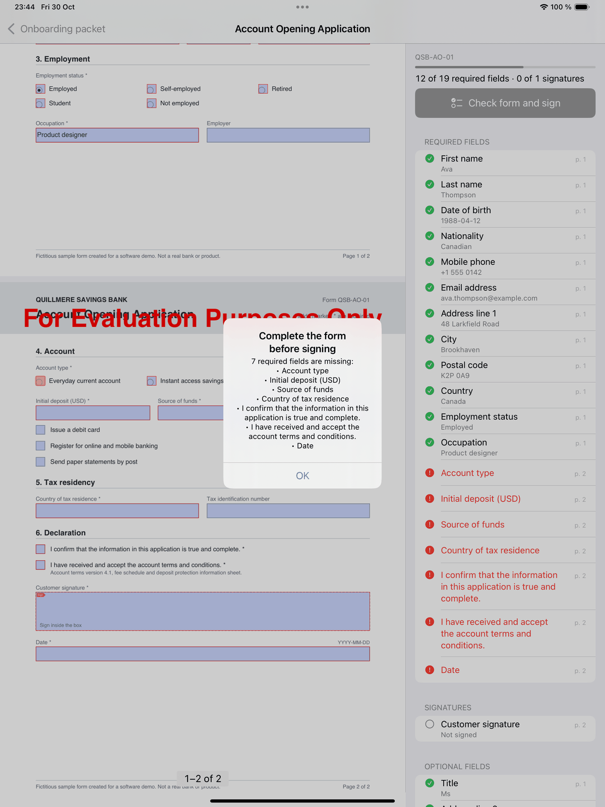
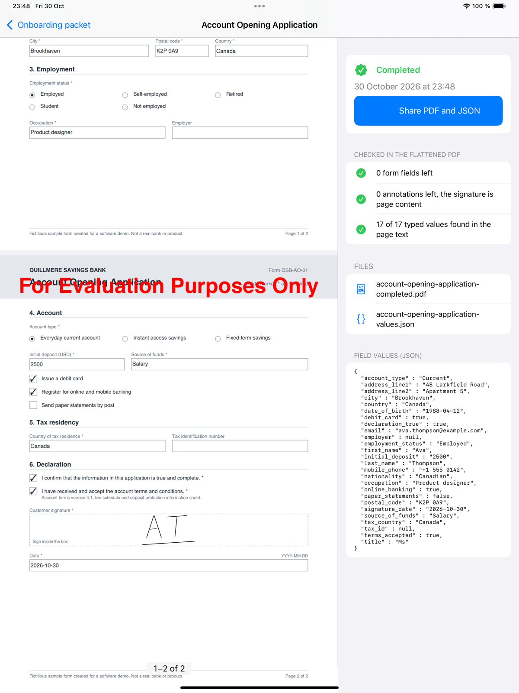

# Nutrient Form Signing on iPad

A Nutrient.io demo that lets a branch adviser or a field agent fill an onboarding packet of PDF forms on an iPad with a customer, checks the required fields before anyone signs, and saves each signed form as a flattened PDF with a JSON file of its values.



1. **Packet.** Three fictitious fillable PDF forms: an account opening application, a privacy and communications consent, and an identity verification record signed by the customer and the staff member. They have text fields, check boxes, radio buttons, date fields and signature fields. Required fields carry the PDF "Required" flag.
2. **Fill.** The SwiftUI `PDFView` of the Nutrient iOS SDK shows the form. Date fields have a date format, so Nutrient opens a calendar. A panel next to the document lists the required fields, the signatures and the optional fields, and updates while the form is filled. The app reads the fields with `PDFFormParser` and `PDFFormField.isRequired`.
3. **Check before signing.** A tap on a signature field, or on **Check form and sign**, first ends the edit in progress and reads every field again. If a required field is empty, or a date cannot be read, the signature sheet does not open (`onDidTapOnAnnotation` returns `true`). An alert lists the missing fields and the panel marks them in red.
4. **Sign.** When the form is complete, the tap opens the Nutrient signature sheet (draw or type). The signature is an ink annotation over the signature field, found with `SignatureFormElement.overlappingSignatureAnnotation`. Signatures are never stored on the device (`signatureSavingStrategy = .neverSave`), because the iPad is shared.
5. **Finish.** `Processor` flattens every annotation, form fields and signatures included, into a new PDF. The app opens the output again and checks that no form field and no annotation is left, and that each typed value is now page text. A JSON file holds the field values, the signatures and the result of these checks.
6. **Share.** The share sheet offers the PDF and the JSON together. Both files are also in Files, On My iPad, Onboarding Packet, Completed.

Each form in the list shows its status (Not started, In progress, Ready to sign, Signed, Completed), a progress bar and the number of required fields and signatures done. Everything runs on the iPad. No server is called.

## Prerequisites

- macOS with Xcode. Tested with Xcode 27.1. The Nutrient 27.1 package manifest needs Swift tools 6.4.
- An iPad or the iPad simulator, iPadOS 17 or later. Tested on the iPad Pro 13-inch (M4) simulator with iOS 18.3. The app is for iPad only.
- Internet access on the first build: Swift Package Manager downloads the Nutrient iOS SDK 27.1.0 from `https://github.com/PSPDFKit/PSPDFKit-SP`.
- Optional: [XcodeGen](https://github.com/yonaskolb/XcodeGen), only to regenerate the Xcode project from `project.yml`.
- Optional: Python 3.10 or later, only to regenerate the forms.

## Environment variables

Start from `.env.example`. The license key is never written in the code.

| Variable | Purpose | Default |
|---|---|---|
| `NUTRIENT_LICENSE_KEY` | Nutrient iOS SDK license key, bound to the bundle ID `io.nutrient.poc.formsigning`. `xcodebuild` reads it from the environment and writes it to `NutrientLicenseKey` in Info.plist. In Xcode, you can also set it as an environment variable of the Run action of the scheme. | empty = trial mode |

In trial mode the SDK adds a "For Evaluation Purposes Only" watermark to the pages, also to the flattened PDFs. Everything else works.

## Build and run

Open the project in Xcode, pick an iPad simulator and run the `OnboardingPacket` scheme:

```bash
open OnboardingPacket.xcodeproj
```

From the command line:

```bash
xcodebuild -project OnboardingPacket.xcodeproj -scheme OnboardingPacket -destination 'platform=iOS Simulator,name=iPad Pro 13-inch (M4)' build
```

With a license key:

```bash
cp .env.example .env
```

```bash
set -a && source .env && set +a && xcodebuild -project OnboardingPacket.xcodeproj -scheme OnboardingPacket -destination 'platform=iOS Simulator,name=iPad Pro 13-inch (M4)' build
```

To regenerate the Xcode project after changing `project.yml`:

```bash
xcodegen generate
```

## Using the app

1. **Packet.** The list shows the three forms with their progress. **New packet** clears every form for the next customer. Files already completed stay in the Completed folder.
2. **Fill.** Open a form and tap its fields. The panel on the right ticks each required field as soon as it has a value. Tap a row of the panel to go to the page of the field.
3. **Check.** Tap **Check form and sign**, or tap a signature box. While required fields are missing, the app lists them and does not open the signature sheet.

   

4. **Sign.** When every required field is filled, the button says **Sign**. Tap the signature box, draw or type the signature, then tap **Add**. The identity verification record has two signature boxes: the customer and the staff member.
5. **Finish.** When every signature is in place, tap **Finish and share**. The completed view shows the flattened PDF, the checks run on it and the field values. **Share PDF and JSON** opens the share sheet.

   

A completed form stays completed after a restart. The list opens it in this view.

## Output

For each completed form the app writes a folder `Completed/<yyyyMMdd-HHmmss>-<form>/` in the app's Documents folder:

| File | Content |
|---|---|
| `<form>-completed.pdf` | The flattened PDF: field values and signatures are page content, no form field or annotation is left |
| `<form>-values.json` | Packet and form, completion time, SDK version, `values` (field name to value), `fields` (label, type, required, page, value), `signatures` (signed or not) and `output` (the checks run on the flattened PDF) |

Check boxes are `true` or `false`, radio buttons hold the export value of the selected button (for example `"Employed"`), empty optional fields are `null`.

```json
"values" : {
  "account_type" : "Current",
  "date_of_birth" : "1988-04-12",
  "debit_card" : true,
  "email" : "ava.thompson@example.com",
  "employer" : null,
  "employment_status" : "Employed",
  "first_name" : "Ava",
  ...
},
"output" : {
  "annotationsLeft" : 0,
  "flattened" : true,
  "formFieldsLeft" : 0,
  "pdf" : "account-opening-application-completed.pdf",
  "textValuesChecked" : 17,
  "textValuesFoundInPdf" : 17
}
```

## UI test

`OnboardingPacketUITests` drives the whole flow on an iPad simulator: it starts a new packet, fills the account opening application, tries to sign too early and checks the alert, fills page 2, draws a signature, finishes the form and opens the share sheet. Then it completes the identity verification record with two signatures and starts the consent form. It takes about ten minutes.

```bash
xcodebuild test -project OnboardingPacket.xcodeproj -scheme OnboardingPacket -destination 'platform=iOS Simulator,name=iPad Pro 13-inch (M4)'
```

The Nutrient form editor does not expose its text input to UI tests, so the test puts each value on the pasteboard and taps the keyboard's Paste button. The test also expects English month names in the date picker. To save its screenshots as PNG files, add `TEST_RUNNER_SHOT_DIR=<folder>` in front of the command. The screenshots of this README come from this test.

## Forms

The forms are generated by `tools/generate_forms.py` with reportlab and pypdf. reportlab draws the pages and creates the text fields, check boxes and radio buttons. pypdf adds the signature fields and the date format (`AFDate_FormatEx("yyyy-mm-dd")`), which makes Nutrient show a calendar. The bank, the people and the wording are fictitious.

```bash
python3 -m venv .venv
```

```bash
.venv/bin/pip install -r tools/requirements.txt
```

```bash
.venv/bin/python tools/generate_forms.py
```

The PDFs are written to `OnboardingPacket/Forms` and bundled with the app. After you regenerate them, tap **New packet** in the app to replace the working copies.

## Project layout

| Path | Content |
|---|---|
| `OnboardingPacket/App.swift` | App entry point, license key |
| `OnboardingPacket/Model/PacketForm.swift` | The forms of the packet |
| `OnboardingPacket/Model/FormInspector.swift` | Reads the fields, required flags, values and signatures |
| `OnboardingPacket/Model/PacketStore.swift` | Working copies, progress, completed forms |
| `OnboardingPacket/Model/FormExporter.swift` | Flattening, checks on the output, JSON |
| `OnboardingPacket/Views/PacketView.swift` | Packet list with the progress of each form |
| `OnboardingPacket/Views/FormFillView.swift` | Document, checklist panel, check before signing |
| `OnboardingPacket/Views/CompletedFormView.swift` | Flattened PDF, checks, values, share sheet |
| `OnboardingPacket/Forms/` | The generated forms |
| `OnboardingPacketUITests/` | UI test of the whole flow |
| `tools/generate_forms.py` | Form generator |
| `project.yml` | XcodeGen definition of the project |

## Limitations

- The signature is an electronic signature: an ink annotation flattened into the page. It is not a digital signature with a certificate. The Nutrient iOS SDK also supports digital signatures, which this demo does not use.
- The check before signing covers required fields and the date format. It does not validate the content of a field, for example an email address or a phone number.
- A field changed after signing does not remove the signature. **Finish and share** checks the required fields again before it flattens the form.
- The completed files are shared with the share sheet. There is no upload to a back office.
